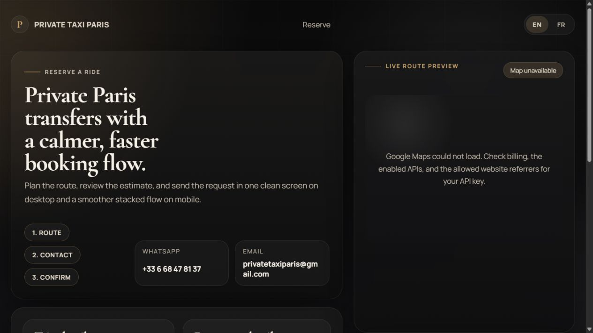
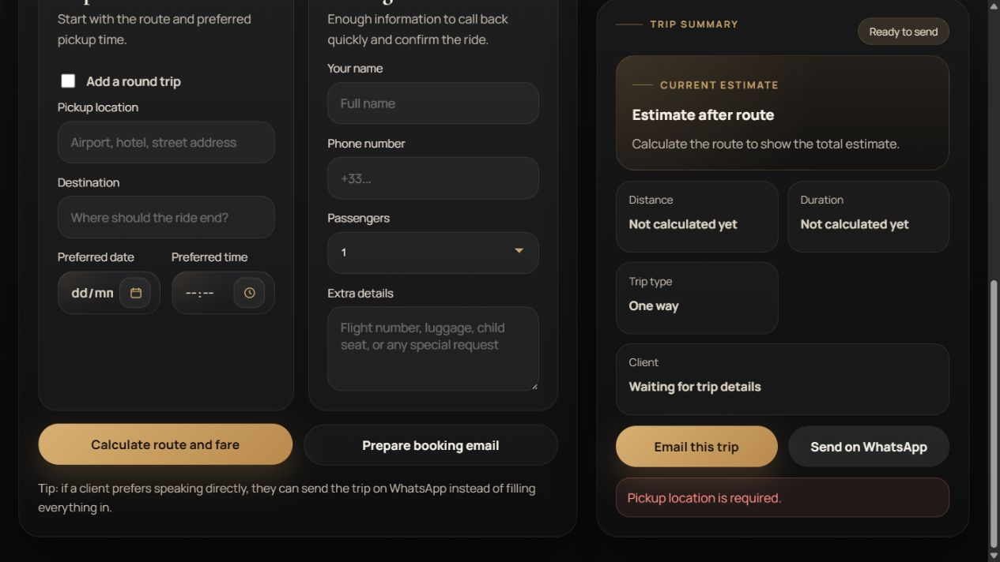
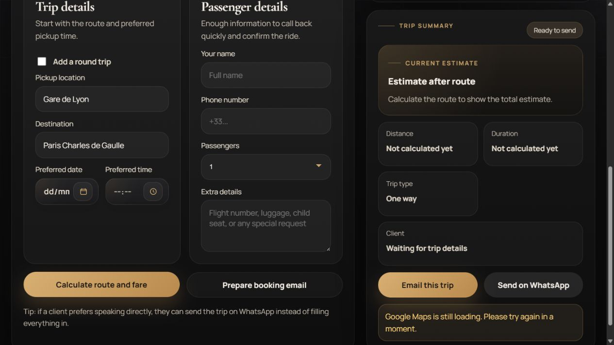
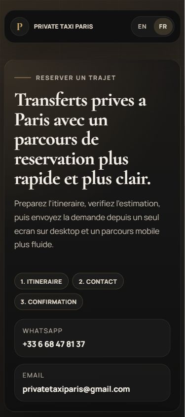
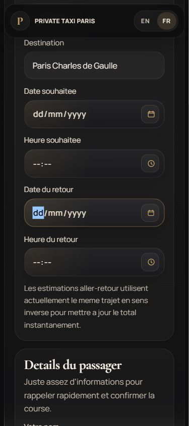

# Private Taxi Paris booking review

21 November 2026 · Local production build · English desktop and French mobile

The current site helps a passenger describe a trip and contact the driver. It cannot tell either person whether the driver received or accepted the request. Give the rider one submission with a reference and give the driver one schedule for web, phone and WhatsApp bookings. A confirmed ride should appear in his Google Calendar. He changes or cancels it in the app.

## 1. Start a request on desktop

The brand, language switch and trip sections are easy to identify. At the captured desktop size, the introductory card and map fill almost the entire first screen. The headline promises a faster booking flow, and the text describes desktop and mobile layout. A visitor looking for a pickup has to scroll. Lead with the service and the pickup field or a direct action that takes focus there.

## 2. Try the form with no pickup

Selecting **Calculate route and fare** produced “Pickup location is required.” Focus stayed on the calculation button. The error appeared under the summary in a different column from the empty field. The same summary still said “Ready to send” and offered email and WhatsApp links containing missing trip details. Keep general contact available, put the error beside the field and give a saved request its own receipt.

The named inputs and live status message are worth keeping. The heading sequence jumps from level one to level three. Review the sequence, field associations, error focus and announcements in the redesign.

## 3. Request an estimate when Maps is unavailable

With external map scripts deliberately blocked, it was still possible to enter Gare de Lyon and Paris Charles de Gaulle. The map displayed billing and API setup advice. Calculating then reported that Maps was still loading. These two messages give the rider conflicting instructions. Tell the rider when an estimate is unavailable and let them submit the entered addresses for driver review.

## 4. Start on a phone in French

At a 390 px viewport width and scroll position zero, the pickup input started about 1,070 px from the top. The heading, three step labels and two contact shortcuts occupied the first screen. The EN/FR switch stayed within reach and changing languages preserved both entered addresses. Keep that behavior. Put the first booking action within the opening screen in both languages.

## 5. Add a return and look for confirmation

The French return-trip control revealed labeled return date and time fields and retained the outbound addresses. Keep this conditional layout. The current form treats the outbound date and time as optional. Its submit handler prepares an email. It does not save a booking, issue a reference or show a driver decision. A scheduled ride needs a future Paris pickup time, a later return when selected, and distinct received and confirmed states.

## Scope of the evidence

The screenshots show the local build from the current source. Its generated JavaScript and CSS filenames matched a fresh production build. The form and summary actions were also checked in `src/App.jsx`. The README describes an embedded Calendly flow, but the rendered page and current component expose no Calendly booking control. Update the documentation for the flow that ships.

No request was sent, no passenger information was used, and no Google account was connected. Live Maps estimates, delivery, production deployment, physical mobile devices and screen-reader behavior were outside this review. The driver workspace and calendar sync are proposed product capabilities. The board tracks their acceptance separately.
